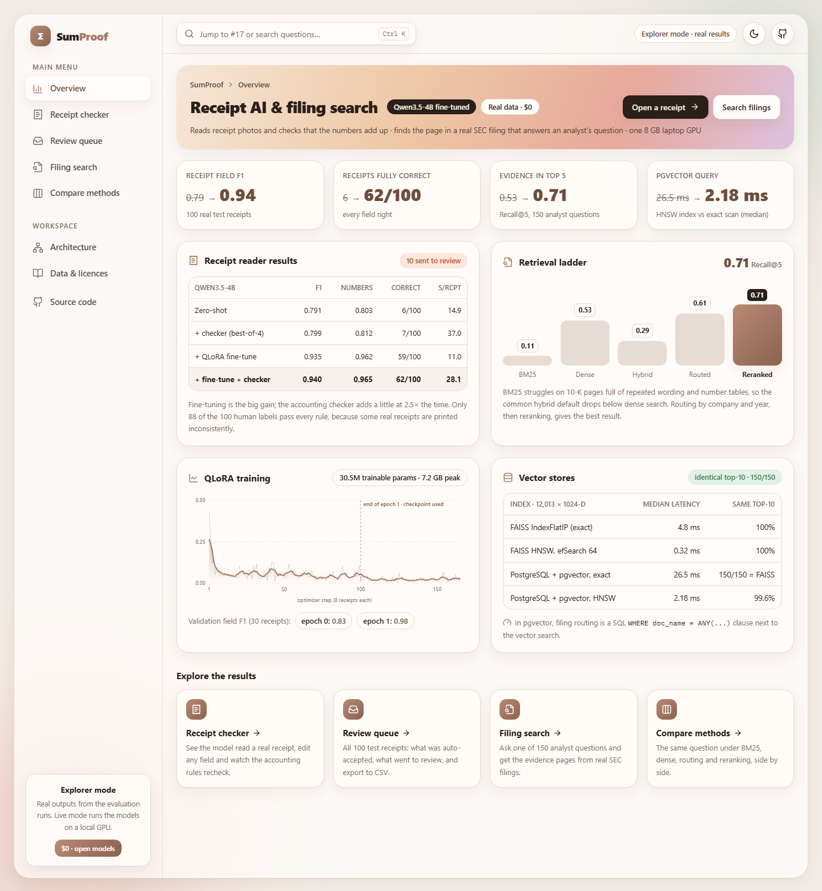
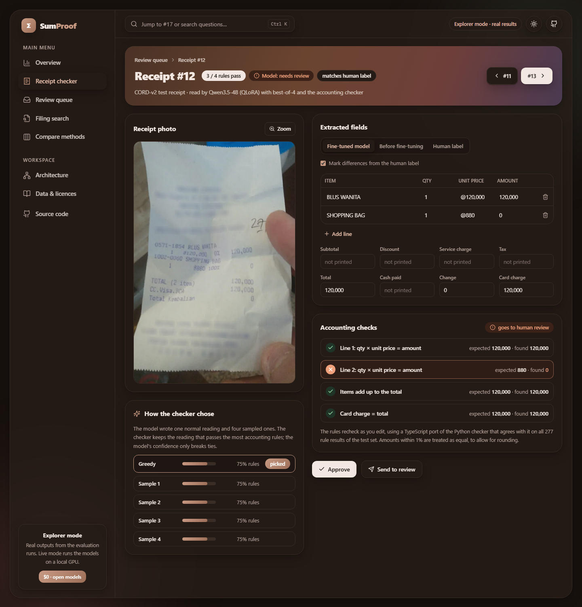

# SumProof

**Receipt AI and financial filing search: reads receipts, checks that the numbers add up, and finds the page in an annual report that answers an analyst's question. Real data, open models, zero cost.**

- **Receipt extraction:** Qwen3.5-4B (Feb 2026), a natively multimodal model, fine-tuned with QLoRA on one 8 GB laptop GPU. Fine-tuning raised field F1 from **0.79 to 0.94** and fully correct receipts from **6 to 62 out of 100**.
- **Accounting checker:** sample several readings and keep the one that obeys the receipt's arithmetic (items sum to the subtotal, subtotal + tax − discount = total, cash − change = total). Readings that break a rule go to human review.
- **Financial retrieval:** search over **12,013 pages of 84 real SEC filings** (FinanceBench), scored against evidence pages labelled by financial analysts. Qwen3-Embedding + company/year routing + Qwen3-Reranker: **Recall@5 0.53 → 0.71**.
- **Vector storage:** FAISS and PostgreSQL + pgvector (with the routing as a SQL filter), verified to return identical results.

## Architecture


Solid boxes run for every request; dashed boxes are offline steps that run once.

**A. Receipt reader** (`sumproof/receipts/`)
1. **Read:** the photo goes straight into Qwen3.5-4B, a vision-language model. Its vision encoder turns the image into up to ~800 image tokens and the language model writes the receipt as JSON. There is no separate OCR step (`vlm.py`).
2. **Sample:** besides the normal (greedy) reading, the model samples 4 more, giving 5 candidates (`vlm.generate`).
3. **Check:** each candidate is tested against the receipt's arithmetic. The checker keeps the one that passes the most rules; if even that one breaks a rule, the receipt goes to human review (`consistency.py`).
4. **Fine-tune (offline):** QLoRA trains a small LoRA adapter (0.67% of the weights) on 800 real CORD receipts while the 4-bit base model stays frozen; the adapter plugs into the language model at inference (`train_qlora.py`).

**B. Financial filing search** (`sumproof/rag/`)
1. **Index (offline):** the 84 filings are split into 12,013 pages and each page is embedded with Qwen3-Embedding into a 1024-number vector (`download_financebench.py`, `financebench.py`).
2. **Route:** the question's company (name, ticker or nickname) and fiscal year select the matching filings (`financebench.build_router`).
3. **Search:** the question is embedded the same way, and exact vector search finds the closest pages among the routed filings, in FAISS (`index.py`) or in PostgreSQL with pgvector, where routing is a SQL `WHERE` clause (`pgstore.py`).
4. **Rerank:** Qwen3-Reranker reads the question and each of the top 30 pages together and reorders them; the output is the evidence pages with their page numbers.

## Interface

A Next.js + TypeScript explorer of the real results ([`web/`](web/)): a receipt checker where you can edit any field and watch the accounting rules recheck live, a review queue with CSV export, filing search with a page viewer, and a side-by-side comparison of the five retrieval steps. Light and dark mocha themes; works on phones.





## Results

### Receipt extraction: CORD-v2 test set (100 real receipts)

| Model | Field F1 | Number fields F1 | Receipts fully correct | Totals correct | s / receipt |
|---|---|---|---|---|---|
| Qwen3.5-4B zero-shot | 0.791 | 0.803 | 6 / 100 | 97.9% | 14.9 |
| + best-of-4 with accounting checker | 0.800 | 0.812 | 7 / 100 | 95.8% | 37.0 |
| **+ QLoRA fine-tune (1 epoch)** | **0.935** | **0.962** | **59 / 100** | **100%** | **11.0** |
| + fine-tune + best-of-4 | **0.940** | **0.965** | **62 / 100** | 99.0% | 28.1 |

All outputs were valid JSON in every run. Field F1 counts every (field, value) pair, with money amounts normalised ("91.000" = "91000"); "number fields" excludes item names.


What the results show:
- **Fine-tuning is the big gain:** +14 points of field F1 and 10× more fully correct receipts. The fine-tuned model is also faster, because it stops inventing fields that are not printed (e.g. `"discount": "0"`).
- **The accounting checker adds a small gain** (+0.5 F1, +3 fully correct receipts) at 2.5× the time, so it suits high-value documents rather than every receipt.
- **Real receipts are not always consistent:** only 88 of the 100 human labels pass every accounting rule. On the others, the checker prefers a reading that adds up over one that copies the odd printed numbers, which costs one total (100% → 99%).
- **Remaining errors are mostly item names, not numbers.** Of 37 mismatched names in the fine-tuned run, 7 differ only in spacing or punctuation, 23 are near-misses (often the model "fixing" words the printer cut short, such as `Garlc` → `Garlic`, or a label typo such as `IVINERAL WATER`), and 7 are real errors such as two lines merged into one. The arithmetic checker cannot catch name errors, which is why its flag recall is low after fine-tuning.
- **Training:** the run was planned for 2 epochs but the host machine ran out of RAM at step 165 of 200; the epoch-1 checkpoint (validation field F1 0.83 → 0.98) is the one evaluated.

### Financial retrieval: FinanceBench (150 analyst questions, 12,013 pages, 84 filings, 32 companies)

All filings are searched together. A question counts as answered when a page the analysts marked as evidence is retrieved.

| Pipeline | Recall@1 | Recall@5 | Recall@10 | Recall@20 | MRR@10 |
|---|---|---|---|---|---|
| BM25 | 0.060 | 0.113 | 0.147 | 0.200 | 0.086 |
| Dense: Qwen3-Embedding-0.6B | 0.300 | 0.527 | 0.687 | 0.760 | 0.412 |
| Hybrid BM25 + dense (RRF) | 0.100 | 0.287 | 0.433 | 0.627 | 0.178 |
| Dense + filing routing | 0.320 | 0.607 | 0.713 | 0.780 | 0.441 |
| **Dense + routing + Qwen3-Reranker-0.6B** | **0.393** | **0.713** | **0.780** | **0.827** | **0.522** |

What the ablation shows:
- **BM25 fails on 10-K filings.** Each company's filings repeat the same vocabulary on hundreds of pages, and answers sit in number tables. The common hybrid default (equal-weight Reciprocal Rank Fusion) therefore *hurts*: Recall@1 drops from 0.30 to 0.10. The pipeline builds on dense retrieval instead.
- **Filing routing** detects the company (name, ticker or common name, e.g. "JPM", "JnJ", "AMEX") and fiscal year in the question and searches only matching filings. It keeps the right filing for 149 of 150 questions; the 3 questions that name no company search every filing.
- **The cross-encoder reranker** gives the largest gain: Recall@5 from 0.527 (dense alone) to 0.713, and from 0.34 to 0.62 on the analysts' open-ended "novel" questions.
- Gold page numbers were checked against the extracted text: 173 of 189 evidence snippets appear verbatim on the labelled page; the rest are tables that PDF text extraction renders differently.

### Vector storage: FAISS and pgvector

| Index (12,013 × 1024-dim vectors) | Median latency | Same top-10 as exact search |
|---|---|---|
| FAISS `IndexFlatIP` (exact, CPU) | 4.8 ms | 100% (reference) |
| FAISS `IndexHNSWFlat`, efSearch 64 | 0.32 ms | 100% |
| PostgreSQL + pgvector, exact scan | 26.5 ms | **150/150 identical to FAISS** |
| PostgreSQL + pgvector, HNSW index | 2.2 ms | 99.6% |

- In pgvector each page row carries `company`, `fiscal_year` and `doc_type`, so filing routing is a SQL `WHERE` clause next to the vector search. With routing, pgvector's results are also identical to FAISS for all 150 questions.
- pgvector's 95th-percentile HNSW latency (27 ms) is higher than its median because Postgres's default 128 MB `shared_buffers` cannot hold the 94 MB index plus table data; raising it is the next tuning step. Postgres's planner also prefers a full scan at this table size, so the benchmark forces the index to measure it.
- At this scale exact search is fast enough and never misses a page, so the evaluation uses exact search; HNSW matters at millions of pages.

## Run it

Receipt training and inference need Linux for Qwen3.5's Triton kernels (WSL2 on Windows works: `scripts/setup_wsl.sh`). Retrieval runs on Windows or Linux; pgvector setup is `scripts/setup_pgvector.sh`.

```bash
pip install -r requirements.txt                   # retrieval, vector stores, tests
pytest -q                                         # 24 tests, no GPU or database needed

# Financial retrieval
python -m sumproof.rag.download_financebench      # questions + 84 filings (~166 MB) -> 12,013 pages
python -m sumproof.rag.financebench               # the five-step table
python -m sumproof.rag.bench_faiss                # FAISS exact vs HNSW
python -m sumproof.rag.pgstore load && python -m sumproof.rag.pgstore bench   # pgvector

# Receipts (Linux / WSL2, 8 GB GPU; CORD-v2 downloads automatically)
pip install -r requirements-gpu.txt               # after installing PyTorch with CUDA
python -m sumproof.receipts.train_qlora --epochs 1 --out runs/sft
bash scripts/run_receipts.sh --eval-only          # the four rows of the receipts table
tensorboard --logdir runs                         # live training dashboard
```

## Project layout

```
sumproof/receipts/   schema, amounts (money parsing), consistency (accounting checker), metrics,
                     vlm (Qwen3.5 loading, sampling, scoring), train_qlora, evaluate, plot_training
sumproof/rag/        download_financebench, financebench (router + five-step evaluation), fusion (BM25 tokens, RRF),
                     index (FAISS), pgstore (PostgreSQL + pgvector), bench_faiss
scripts/             setup_wsl.sh, setup_pgvector.sh, run_receipts.sh, wsl.sh
results/             summary JSON for every number in this README
tests/               receipts (parsing, checker, metrics) and retrieval (router, fusion, FAISS, metrics)
web/                 Next.js + TypeScript interface (see web/README.md); data from `python -m sumproof.export_web`
```

## Engineering notes

- **8 GB GPU budget:** language layers in 4-bit NF4, vision encoder in bf16 (quantising it hit a slow bitsandbytes kernel path and made extraction about 3× slower). Qwen3.5's vocabulary has 248k tokens, so logits are produced only for answer tokens during training (`logits_to_keep`). Peak GPU memory in training: 7.2 GB.
- **LoRA targets** cover all three layer types in Qwen3.5's language model: 8 standard attention layers, 24 Gated DeltaNet linear-attention layers and 32 MLPs (200 modules, 30.5M trainable parameters, 0.67%). The vision encoder stays frozen; the target regex is anchored on `language_model` because vision blocks reuse some layer names.
- **Thinking mode is disabled** in the chat template so the model answers with JSON directly.
- **Candidate scoring** appends generated tokens to the prompt; Qwen3.5's per-token `mm_token_type_ids` must be extended to match, or position indexing fails.

## Data and licences

- Code: MIT (see `LICENSE`). The licence covers the code in this repository only; no dataset or model weights are included.
- CORD-v2: CC-BY-4.0, NAVER Clova (real Indonesian receipts), downloaded at run time.
- FinanceBench: CC-BY-NC-4.0, Patronus AI (real SEC filings, analyst-written questions and evidence), downloaded at run time; non-commercial use.
- Models: Qwen3.5-4B, Qwen3-Embedding-0.6B and Qwen3-Reranker-0.6B, all Apache-2.0, downloaded from Hugging Face.
