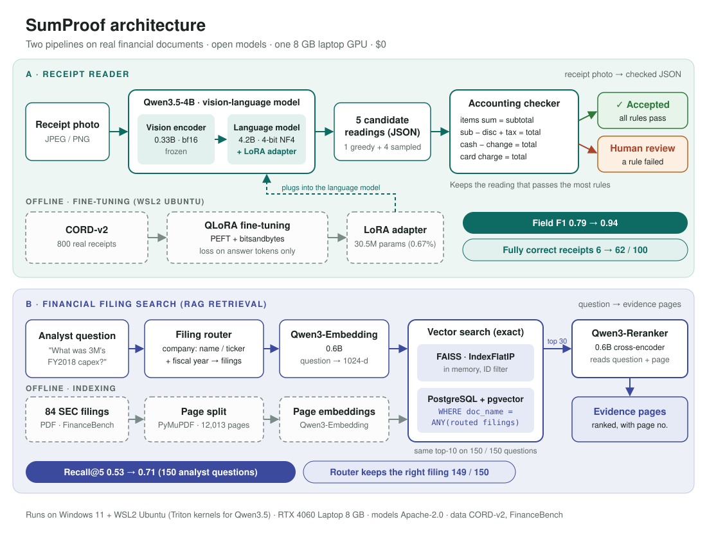
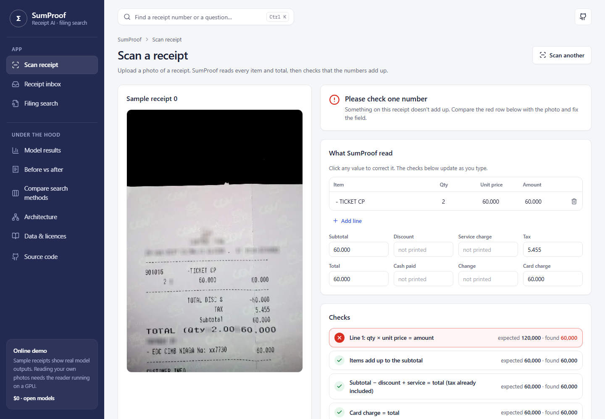
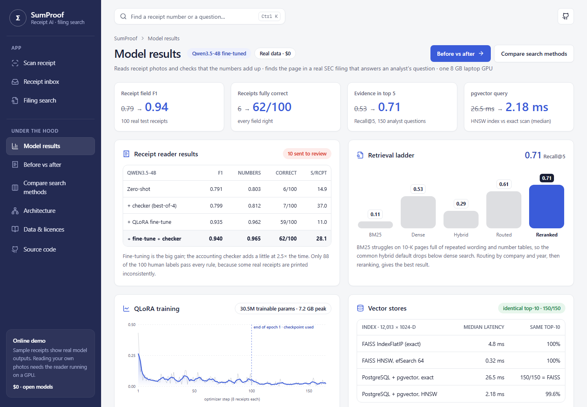
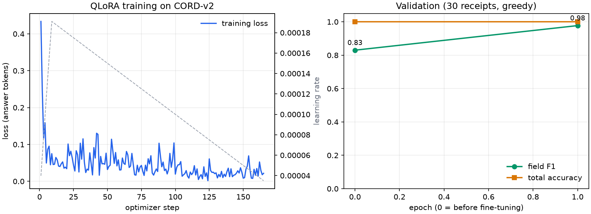

<div align="center">


# SumProof

**Receipt AI that checks the numbers add up, and cited answers from real SEC filings.**<br>
Real data · open models · one 8 GB laptop GPU · $0

<p>
  <a href="https://sumproof.vercel.app"><b>▶ Live demo: sumproof.vercel.app</b></a>
</p>

<p>
  <b>Models</b><br>
  
  
  
</p>

<p>
  <b>Machine learning</b><br>
  
  
  
  
  
  
  
</p>

<p>
  <b>Retrieval and storage</b><br>
  
  
  
  
</p>

<p>
  <b>Interface</b><br>
  
  
  
  
  
</p>

<p>
  <a href="https://sumproof.vercel.app">Live demo</a> ·
  <a href="#architecture">Architecture</a> ·
  <a href="#interface">Interface</a> ·
  <a href="#results">Results</a> ·
  <a href="#run-it">Run it</a> ·
  <a href="#data-and-licences">Data &amp; licences</a>
</p>

</div>

## Highlights

- **Receipt extraction:** Qwen3.5-4B (Feb 2026), a natively multimodal model, fine-tuned with QLoRA on one 8 GB laptop GPU. Fine-tuning raised field F1 from **0.79 to 0.94** and fully correct receipts from **6 to 62 out of 100**.
- **Accounting checker:** sample several readings and keep the one that obeys the receipt's arithmetic (items sum to the subtotal, subtotal + tax − discount = total, cash − change = total). Readings that break a rule go to human review.
- **Financial retrieval:** search over **12,013 pages of 84 real SEC filings** (FinanceBench), scored against evidence pages labelled by financial analysts. Qwen3-Embedding + company/year routing + Qwen3-Reranker: **Recall@5 0.53 → 0.71**.
- **Local agent (MCP + Ollama):** SumProof's tools served over the Model Context Protocol and used by Qwen3.5-4B in Ollama: 100% on 22 receipt tasks; on calculation questions it matches plain RAG, because the 4B model calls the calculator in only 4% of tasks.
- **Vector storage:** FAISS and PostgreSQL + pgvector (with the routing as a SQL filter), verified to return identical results.
- **Answer generation (RAG):** Qwen3.5-4B answers the 150 questions from the retrieved pages with a citation, graded against the analysts' answers. RAG raises correct answers from **8% to 35%**; gating the pages by reranker confidence cuts prompt tokens by **28%** with no statistically significant accuracy change. On calculation questions, a **thinking budget** raises accuracy from **38% to 68%** and cuts wrong answers from **60% to 14%**.

## Architecture



Solid boxes run for every request; dashed boxes are offline steps that run once.

**A. Receipt reader** (`sumproof/receipts/`)
1. **Read:** the photo goes straight into Qwen3.5-4B, a vision-language model. Its vision encoder turns the image into up to ~800 image tokens and the language model writes the receipt as JSON. There is no separate OCR step (`vlm.py`).
2. **Sample:** besides the normal (greedy) reading, the model samples 4 more, giving 5 candidates (`vlm.generate`).
3. **Check:** each candidate is tested against the receipt's arithmetic. The checker keeps the one that passes the most rules; if even that one breaks a rule, the receipt goes to human review (`consistency.py`).
4. **Fine-tune (offline):** QLoRA trains a small LoRA adapter (0.67% of the weights) on 800 real CORD receipts while the 4-bit base model stays frozen; the adapter plugs into the language model at inference (`train_qlora.py`).

**B. Financial filing search** (`sumproof/rag/`)
1. **Index (offline):** the 84 filings are split into 12,013 pages and each page is embedded with Qwen3-Embedding into a 1024-number vector (`download_financebench.py`, `financebench.py`).
2. **Route:** the question's company (name, ticker or nickname) and fiscal year select the matching filings (`financebench.build_router`).
3. **Search:** the question is embedded the same way, and exact vector search finds the closest pages among the routed filings, in FAISS (`index.py`) or in PostgreSQL with pgvector, where routing is a SQL `WHERE` clause (`pgstore.py`).
4. **Rerank:** Qwen3-Reranker reads the question and each of the top 30 pages together and reorders them; the output is the evidence pages with their page numbers.

## Interface

A Next.js + TypeScript app ([`web/`](web/)), live at **[sumproof.vercel.app](https://sumproof.vercel.app)**, in two parts:

- **The app**, for people who just want the result: upload a receipt photo and get the items and totals back with a plain answer, *"Everything adds up"* or *"Please check one number"*. Fix any field and the checks rerun as you type; save, flag or download as CSV. Filing search finds the pages of an SEC filing that answer a question.
- **Under the hood**, for technical readers: the model results dashboard, before vs after fine-tuning on every test receipt, the five retrieval steps side by side, and the architecture.

Reading your own photos needs the fine-tuned model on a GPU (see *Run it*); the free online demo shows the model's real saved readings of the 100 test receipts.





## Results

### Receipt extraction: CORD-v2 test set (100 real receipts)

| Model | Field F1 | Number fields F1 | Receipts fully correct | Totals correct | s / receipt |
|---|---|---|---|---|---|
| Qwen3.5-4B zero-shot | 0.791 | 0.803 | 6 / 100 | 97.9% | 14.9 |
| + best-of-4 with accounting checker | 0.800 | 0.812 | 7 / 100 | 95.8% | 37.0 |
| **+ QLoRA fine-tune (1 epoch)** | **0.935** | **0.962** | **59 / 100** | **100%** | **11.0** |
| + fine-tune + best-of-4 | **0.940** | **0.965** | **62 / 100** | 99.0% | 28.1 |

All outputs were valid JSON in every run. Field F1 counts every (field, value) pair, with money amounts normalised ("91.000" = "91000"); "number fields" excludes item names.



What the results show:
- **Fine-tuning is the big gain:** +14 points of field F1 and 10× more fully correct receipts. The fine-tuned model is also faster, because it stops inventing fields that are not printed (e.g. `"discount": "0"`).
- **The accounting checker adds a small gain** (+0.5 F1, +3 fully correct receipts) at 2.5× the time, so it suits high-value documents rather than every receipt.
- **Real receipts are not always consistent:** only 88 of the 100 human labels pass every accounting rule. On the others, the checker prefers a reading that adds up over one that copies the odd printed numbers, which costs one total (100% → 99%).
- **Remaining errors are mostly item names, not numbers.** Of 37 mismatched names in the fine-tuned run, 7 differ only in spacing or punctuation, 23 are near-misses (often the model "fixing" words the printer cut short, such as `Garlc` → `Garlic`, or a label typo such as `IVINERAL WATER`), and 7 are real errors such as two lines merged into one. The arithmetic checker cannot catch name errors, which is why its flag recall is low after fine-tuning.
- **Training:** the run was planned for 2 epochs but the host machine ran out of RAM at step 165 of 200; the epoch-1 checkpoint (validation field F1 0.83 → 0.98, tracked on the first 30 validation receipts during training) is the one evaluated. Re-scored afterwards on all 100 validation receipts, it reaches field F1 0.96 with every total correct (`results/val_sft.json`).

### Financial retrieval: FinanceBench (150 analyst questions, 12,013 pages, 84 filings, 32 companies)

All filings are searched together. A question counts as answered when a page the analysts marked as evidence is retrieved.

| Pipeline | Recall@1 | Recall@5 | Recall@10 | Recall@20 | MRR@10 |
|---|---|---|---|---|---|
| BM25 | 0.060 | 0.113 | 0.147 | 0.200 | 0.086 |
| Dense: Qwen3-Embedding-0.6B | 0.300 | 0.527 | 0.687 | 0.760 | 0.412 |
| Hybrid BM25 + dense (RRF) | 0.100 | 0.287 | 0.433 | 0.627 | 0.178 |
| Dense + filing routing | 0.320 | 0.607 | 0.713 | 0.780 | 0.441 |
| **Dense + routing + Qwen3-Reranker-0.6B** | **0.393** | **0.713** | **0.780** | **0.827** | **0.522** |

What the ablation shows:
- **BM25 fails on 10-K filings.** Each company's filings repeat the same vocabulary on hundreds of pages, and answers sit in number tables. The common hybrid default (equal-weight Reciprocal Rank Fusion) therefore *hurts*: Recall@1 drops from 0.30 to 0.10. The pipeline builds on dense retrieval instead.
- **Filing routing** detects the company (name, ticker or common name, e.g. "JPM", "JnJ", "AMEX") and fiscal year in the question and searches only matching filings. It keeps the right filing for 149 of 150 questions; the 3 questions that name no company search every filing.
- **The cross-encoder reranker** gives the largest gain: Recall@5 from 0.527 (dense alone) to 0.713, and from 0.34 to 0.62 on the analysts' open-ended "novel" questions.
- Gold page numbers were checked against the extracted text: 173 of 189 evidence snippets appear verbatim on the labelled page; the rest are tables that PDF text extraction renders differently.

### Vector storage: FAISS and pgvector

| Index (12,013 × 1024-dim vectors) | Median latency | Same top-10 as exact search |
|---|---|---|
| FAISS `IndexFlatIP` (exact, CPU) | 4.8 ms | 100% (reference) |
| FAISS `IndexHNSWFlat`, efSearch 64 | 0.32 ms | 100% |
| PostgreSQL + pgvector, exact scan | 26.5 ms | **150/150 identical to FAISS** |
| PostgreSQL + pgvector, HNSW index | 2.2 ms | 99.6% |

- In pgvector each page row carries `company`, `fiscal_year` and `doc_type`, so filing routing is a SQL `WHERE` clause next to the vector search. With routing, pgvector's results are also identical to FAISS for all 150 questions.
- pgvector's 95th-percentile HNSW latency (27 ms) is higher than its median because Postgres's default 128 MB `shared_buffers` cannot hold the 94 MB index plus table data; raising it is the next tuning step. Postgres's planner also prefers a full scan at this table size, so the benchmark forces the index to measure it.
- At this scale exact search is fast enough and never misses a page, so the evaluation uses exact search; HNSW matters at millions of pages.

### Answer generation: FinanceBench (150 analyst questions)

Qwen3.5-4B (4-bit, no thinking) answers every question four ways, from the same retrieved pages as above, and must cite the page it used or reply "Not found". No model was trained for this step.

| Context given to the model | Correct | Wrong | Refused | Evidence page in context | Prompt tokens |
|---|---|---|---|---|---|
| None (closed book) | 8.0% | 58.7% | 33.3% | n/a | 113 |
| **Top 5 reranked pages (RAG)** | **35.3%** | 59.3% | 5.3% | 71% | 5,089 |
| **Confidence-gated pages (1 to 5)** | 32.7% | 56.7% | 10.0% | 64% | **3,689 (−28%)** |
| The analysts' evidence pages (ceiling) | 44.0% | 51.3% | 4.7% | 100% | 1,320 |

- **Closed book, the model invents answers:** 59% wrong and 0% correct on the metric questions, although it was told to say "I don't know". The filings are essential.
- **Confidence-gated context:** softmax the reranker scores of the top 5 pages and keep pages until they hold 90% of the probability (fixed in advance, like nucleus sampling, not tuned on these questions). On average 3.5 pages instead of 5. Paired against top 5: 11 questions got worse and 7 better (McNemar exact p = 0.48, not significant). When gating drops the evidence page, the model more often says "Not found" (refusals 5% → 10%) instead of guessing.
- **The generator is now the bottleneck:** even with the analysts' own pages a 4B model answers 44%, because most metric questions need multi-step arithmetic (ratios, averages). Retrieval costs 8.7 points; reasoning costs far more.
- **Citations:** 69% of correct RAG answers cite one of the analysts' evidence pages.
- **Grading:** questions whose reference is one figure are graded by an exact rule (the stated figure within 1%, units aware); the other 356 answers are graded by **IBM Granite 4.2 8B**, a different model family from the generator, so no model grades its own writing. On the 161 answers both graded, they agree **92.5%**. A hand check of 20 Granite grades agreed with 17; the 3 disagreements were all Granite being too strict, so the explanation-question scores are conservative.
- An early version of the rule accepted any matching number in the answer, including numbers from the working; checking it against the model grader (80% agreement) exposed this, and grading the stated figure raised agreement to 92.5%.

### Thinking budget: how much reasoning is worth paying for

The ceiling row above shows that the model, not retrieval, is now the bottleneck: many metric questions need multi-step arithmetic. Qwen3.5 can reason before answering, but left alone a 4B model sometimes reasons for over 6,000 tokens and never answers. **Budget forcing** (Muennighoff et al., 2025, *s1: Simple test-time scaling*) caps the reasoning: when the budget runs out, the reasoning is closed and the model must answer. Run through Ollama on the 50 metric questions, same top-5 pages, greedy decoding:

| Thinking budget | Correct | Wrong | Refused | Thinking tokens (mean) | Seconds / question |
|---|---|---|---|---|---|
| None | 38% | 60% | 2% | 0 | 4 |
| 1,024 tokens | 50% | 34% | 16% | 1,022 | 18 |
| 2,048 tokens | 54% | 28% | 18% | 1,974 | 34 |
| **4,096 tokens** | **68%** | **14%** | 18% | 3,265 | 54 |

- **Every budget helps, and the gain is not noise:** none → 4,096 fixed 15 questions and broke none (McNemar exact p = 0.0001); 2,048 → 4,096 fixed 7 and broke none (p = 0.016).
- **Wrong answers fall from 60% to 14%.** With room to reason, the model notices when the pages lack something it needs (for example the prior year's inventory for an average) and says "Not found" instead of inventing a number. For a finance tool, a confident wrong figure is the costliest failure.
- **The cost is time:** 13 times slower at 4,096 tokens, and 20 of the 50 questions still used the whole budget, so larger budgets may help further.
- All 50 references are single figures, so every answer here is graded by the exact rule; no model judge is involved. The reasoning is generated once and cut at each smaller budget, so every budget sees the same thinking prefix.

### Local agent: MCP tools used by Qwen3.5-4B in Ollama

`sumproof/agent/server.py` is an MCP server (Model Context Protocol, `mcp` 2.3) with five tools: `search_filings` (the routed + reranked retrieval above), `read_page`, `calculate` (exact arithmetic, refuses anything but maths), `list_receipts` and `get_receipt` (the fine-tuned model's readings and the accounting checks). Any MCP client can use it; `sumproof/agent/agent.py` connects Qwen3.5-4B in Ollama over stdio and loops until the model answers.

| Condition | Receipt tasks (22, exact answers) | FinanceBench metric questions (50) | Tasks that called `calculate` |
|---|---|---|---|
| Agent, all tools | **100%** | 40% | 4% |
| Agent without `calculate` | 95.5% | 38% | n/a |

- **Lookups work:** the agent picks the right tool and answers every receipt task, about 1 s each.
- **On calculations, tools did not help, because the model rarely used them.** Told to use `calculate` for every arithmetic step, the 4B model called it in 4% of tasks; asked for a ratio, it typically reads the page and returns a raw figure. The agent matches plain top-5 RAG on the same 50 questions (40%).
- **Reasoning beat tools:** the thinking budget lifted the same questions to 68%. For a small model, room to think matters far more than tools it does not decide to call; the next step is to combine both (thinking agent), or to train tool use (GRPO with the checker as reward).
- Building the agent surfaced two design points: MCP 2.x hides tool exceptions from the model by default, so input errors are raised as `ToolError` to let the model correct itself; and tools return parsed numbers, because "60.000" on an Indonesian receipt means sixty thousand.

## Run it

Receipt training and inference need Linux for Qwen3.5's Triton kernels (WSL2 on Windows works: `scripts/setup_wsl.sh`). Retrieval runs on Windows or Linux; pgvector setup is `scripts/setup_pgvector.sh`.

```bash
pip install -r requirements.txt                   # retrieval, vector stores, tests
pytest -q                                         # 39 tests, no GPU or database needed

# Financial retrieval
python -m sumproof.rag.download_financebench      # questions + 84 filings (~166 MB) -> 12,013 pages
python -m sumproof.rag.financebench               # the five-step table
python -m sumproof.rag.bench_faiss                # FAISS exact vs HNSW
python -m sumproof.rag.pgstore load && python -m sumproof.rag.pgstore bench   # pgvector
python -m sumproof.rag.answer generate            # GPU: 600 answers (4 settings x 150), ~50 min
python -m sumproof.rag.answer judge               # GPU: grading with Granite 4.2 8B, ~40 min
python -m sumproof.rag.answer report              # the answer-generation table
python -m sumproof.rag.think_budget               # Ollama (qwen3.5:4b): thinking budgets 0 / 1k / 2k / 4k, ~1 h
python -m sumproof.agent.agent "Which receipts need review?"   # the MCP agent (needs: ollama pull qwen3.5:4b)
python -m sumproof.agent.eval run && python -m sumproof.agent.eval report   # 144 agent runs, ~1.5 h

# Receipts (Linux / WSL2, 8 GB GPU; CORD-v2 downloads automatically)
pip install -r requirements-gpu.txt               # after installing PyTorch with CUDA
python -m sumproof.receipts.train_qlora --epochs 1 --out runs/sft
bash scripts/run_receipts.sh --eval-only          # the four rows of the receipts table
tensorboard --logdir runs                         # live training dashboard

# Live receipt reading in the interface
bash scripts/serve.sh                             # FastAPI reader on localhost:8000 (fine-tuned model)
cd web && npm install && npm run dev              # open http://localhost:3000 and upload a photo
```

## Project layout

```
sumproof/receipts/   schema, amounts (money parsing), consistency (accounting checker), metrics,
                     vlm (Qwen3.5 loading, sampling, scoring), train_qlora, evaluate, plot_training
sumproof/rag/        download_financebench, financebench (router + five-step evaluation), fusion (BM25 tokens, RRF),
                     index (FAISS), pgstore (PostgreSQL + pgvector), bench_faiss, answer (generation + grading)
sumproof/api.py      live reader for the interface (FastAPI: POST a photo, get the fields)
scripts/             setup_wsl.sh, setup_pgvector.sh, run_receipts.sh, serve.sh, wsl.sh
results/             summary JSON for every number in this README
tests/               receipts (parsing, checker, metrics), retrieval (router, fusion, FAISS, metrics), live reader API
web/                 Next.js + TypeScript interface (see web/README.md); data from `python -m sumproof.export_web`
```

## Engineering notes

- **8 GB GPU budget:** language layers in 4-bit NF4, vision encoder in bf16 (quantising it hit a slow bitsandbytes kernel path and made extraction about 3× slower). Qwen3.5's vocabulary has 248k tokens, so logits are produced only for answer tokens during training (`logits_to_keep`). Peak GPU memory in training: 7.2 GB.
- **LoRA targets** cover all three layer types in Qwen3.5's language model: 8 standard attention layers, 24 Gated DeltaNet linear-attention layers and 32 MLPs (200 modules, 30.5M trainable parameters, 0.67%). The vision encoder stays frozen; the target regex is anchored on `language_model` because vision blocks reuse some layer names.
- **Thinking mode is disabled** in the chat template so the model answers with JSON directly.
- **Candidate scoring** appends generated tokens to the prompt; Qwen3.5's per-token `mm_token_type_ids` must be extended to match, or position indexing fails.

## Data and licences

- Code: MIT (see `LICENSE`). The licence covers the code in this repository only; no dataset or model weights are included.
- CORD-v2: CC-BY-4.0, NAVER Clova (real Indonesian receipts), downloaded at run time.
- FinanceBench: CC-BY-NC-4.0, Patronus AI (real SEC filings, analyst-written questions and evidence), downloaded at run time; non-commercial use.
- Models: Qwen3.5-4B, Qwen3-Embedding-0.6B and Qwen3-Reranker-0.6B, all Apache-2.0, downloaded from Hugging Face.
